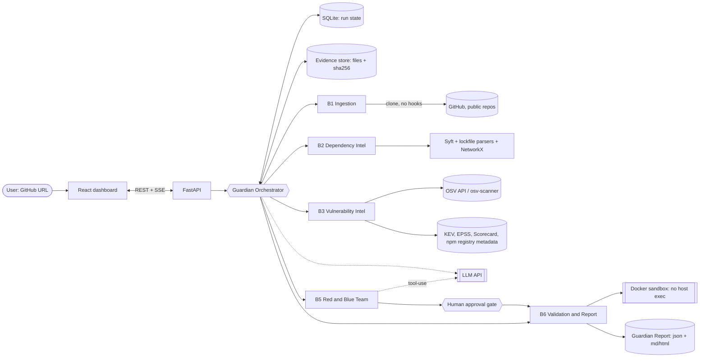
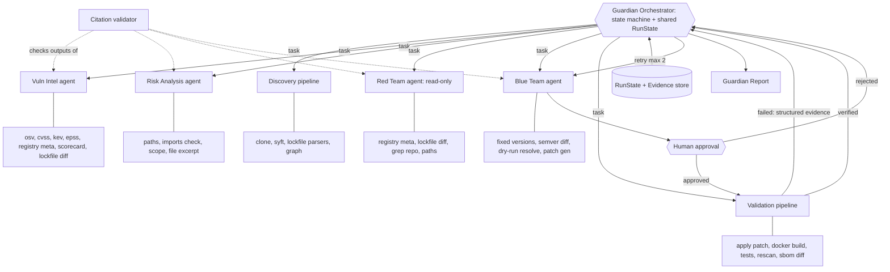
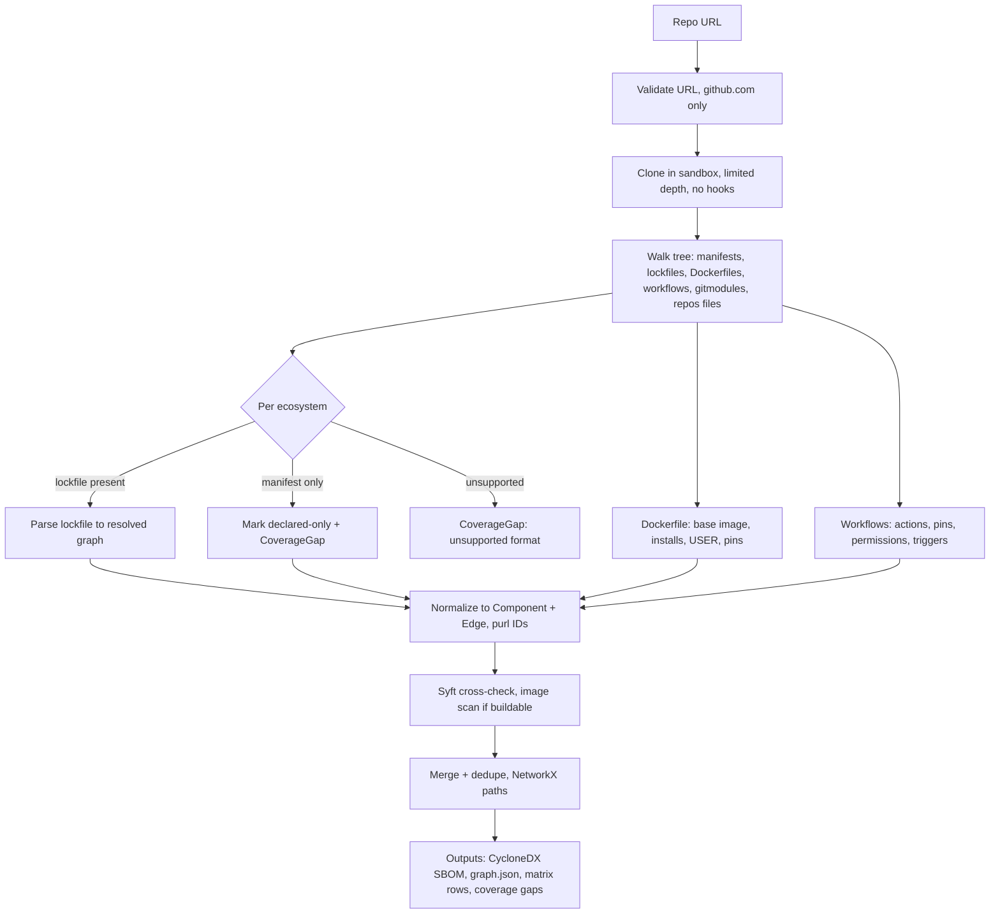
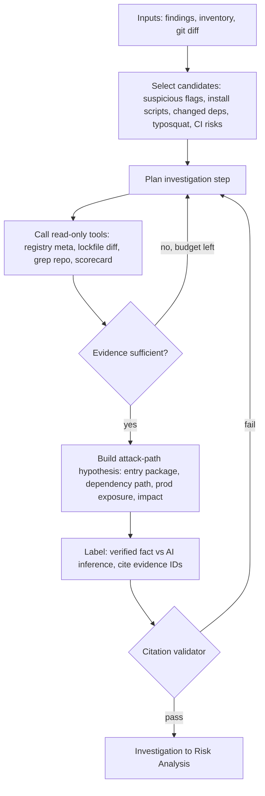
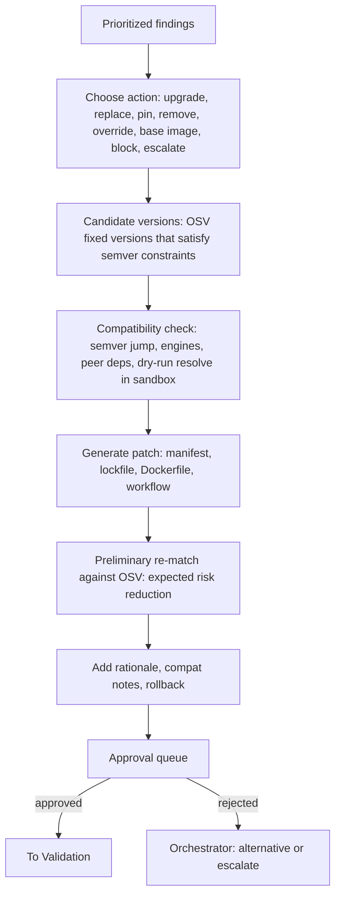
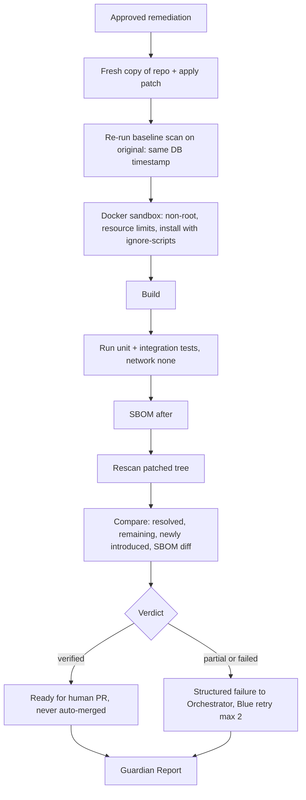

# Software Supply Chain Guardian — Architecture & 2-Day Plan

Status: DRAFT for team review. Items marked **DECIDE** need a team decision before the contract freeze.

---

## 0. TL;DR

1. **Do not make TurtleBot3 the primary demo target.** It has no lockfiles and no resolvable dependency tree (details in §2.1). Use a *seeded fork* of a small npm (or Python) app as the primary target. Keep TurtleBot3 as a secondary "honest coverage gaps" case.
2. **Go deep on one ecosystem (npm), plus Dockerfile and GitHub Actions.** Everything else is an extension point that reports a coverage gap.
3. **Agents only where judgment is needed.** Discovery and Validation are deterministic pipelines. The agentic parts are Risk, Red Team, Blue Team and the Orchestrator's decisions. Scores come from a formula, not the LLM.
4. **Your six blocks leave out the frontend, API, DB and shared contracts.** Add a "platform" owner or those will collide on Day 2.
5. **Freeze the contracts (§5) in the first 2 hours of Day 1, then build against hand-written fixtures.**

---

## 1. What the Bosch problem statement actually requires

Your master context is a superset of the PDF. These are the PDF items that are easy to miss:

| PDF requirement | Where it lands |
|---|---|
| Day 1: at least **one non-CVE supply-chain anomaly** | Block 3 suspicious detectors (§6, B3) |
| Day 1: inspect at least **one container image or CI/CD workflow** | Block 2 Dockerfile + workflow parsers |
| Day 1: show **what changed** ("what is in the app, what changed, what looks risky") | Lockfile git-diff detectors; needs git history from B1 |
| Day 2: risk = severity × **exploitability, reachability, exposure, prod use**; **explainable score + confidence** | Deterministic scoring formula (§4.3) |
| Day 2: **separate verified evidence from AI inference** | `Finding.evidence_class` + citation validator (§4.4) |
| Day 2: recommendation includes **expected risk reduction, compatibility impact, rollback** | `Remediation` schema (§5) |
| Day 2: validate = apply in sandbox → build → **unit + integration tests** → rescan → **before/after SBOM** → **detect newly introduced issues** | Block 6 (§6, B6; flowchart 6) |
| Deliverable: **sample policies and prompts** in the repo | `policies/` and `prompts/` folders (§9) |
| Deliverable: architecture diagram with **approval points and evidence storage** | Flowchart 1 |
| Deliverable: **Responsible AI note** (hallucination control, approvals, secret protection) | §12 |
| Deliverable: Guardian Report **human- and machine-readable** | Block 6: `report.json` + `report.md/html` |
| Out of scope: publishing malicious packages, real creds, auto-merge, touching others' infra | §12 safety rules |
| Stretch: reachability, auto-PR, provenance, policy-as-code, monitoring | §10 — cheap versions of reachability and policy-as-code are in the core plan |

Demo script to design backwards from (PDF Day 2): **"Show us how the Guardian takes a finding from detection to verified remediation."**

---

## 2. Critical review

### 2.1 TurtleBot3 as primary target — verified facts

Checked via the GitHub API on the default branch (`main`):

- **No lockfiles, no `package.json`, `requirements.txt`, `pom.xml`, `Cargo.toml`, `go.mod`.** The only Python manifest is `turtlebot3_example/setup.py` with `install_requires=['setuptools', 'launch']`.
- C++/Python deps live in ROS `package.xml` as **rosdep keys with no versions** (e.g. `rclcpp`, `tf2_ros`). They resolve through apt and the ROS index at build time, so they cannot be resolved statically.
- `turtlebot3.repos` lists 6 git dependencies, all at `version: main` (floating branch, not a commit).
- `docker/jazzy/Dockerfile`: `FROM ros:jazzy-ros-base` (tag, not digest) plus a very large unpinned `apt-get install ros-jazzy-desktop …` list.
- Build needs a ROS image of several GB, `colcon`, and a long compile. Running it for real needs a robot or a Gazebo simulation.

Consequences against the PDF's own sample-app guidelines ("realistic dependency tree with direct **and transitive** dependencies", "build, test and scan locally"):

- The **before/after validation loop** (build → test → rescan) would take far too long to run repeatedly on Day 2.
- Syft and OSV-Scanner have nothing to parse in the source tree. *(I believe neither understands ROS `package.xml`. Confirm with a 5-minute run once they are installed. They are not installed on this machine yet.)* The only real inventory comes from scanning a built image.
- It is good for showing: unpinned git deps, unpinned base image, unpinned apt, and "here is exactly what we could not resolve and why". That is the credibility story, so keep it as the **secondary** demo.

**Recommended primary target: a seeded fork** of a small open-source app that has a lockfile, Dockerfile, GitHub workflow and a test suite that runs in under ~2 minutes. Seed it in your own fork/sandbox (never publish anything):

| Seeded item | PDF category | Notes |
|---|---|---|
| Old direct dep with a known CVE (e.g. an old `lodash`) | Vulnerable direct dep | Pick versions from OSV on setup day; verify the fixed version exists |
| Old transitive dep with a known CVE (e.g. an old `minimist`/`semver` via another dep) | Vulnerable transitive dep | Should come with a fix that needs an `overrides` entry, not a direct bump |
| One commit that edits a lockfile `integrity`/`resolved` entry without a version bump | Unexpected lockfile change | This is the "what changed" demo |
| A typosquat-style name as a **local `file:` dependency** (e.g. `expresss`) | Typosquatted package | Local `file:` so no real registry package is ever fetched or executed |
| A dep with `hasInstallScript: true` that was added recently | Unsafe install script | Same: local package |
| Dockerfile with `FROM node:latest`, root user, `curl … \| sh` | Untrusted/unpinned image | |
| Workflow with tag-pinned actions, no `permissions:`, `pull_request_target` | Unsafe CI/CD | |

Candidate base apps: any small Express/Flask app you already know builds. **DECIDE** the app by the end of Day 1 hour 1; vet it by running `npm ci && npm test` (or the Python equivalent) in Docker.

### 2.2 What is really "agentic" here

Running Syft is not a decision, so an "agent" wrapping it is a function call with a prompt. Reviewers will notice. Split cleanly:

| Component | Type | Why |
|---|---|---|
| Ingestion, Discovery, SBOM, graph, matrix | **Deterministic pipeline** (called as tools) | Must be reproducible; evidence must come from tools |
| Vulnerability Intelligence | Thin agent over deterministic tools | Agent decides which extra lookups to do (registry metadata, Scorecard, KEV/EPSS) per finding |
| Risk Analysis | **Real agent**: investigates, calls tools, writes narrative | Judgment: reachability, exposure, context |
| Red Team | **Real agent, read-only tools** | Investigates non-CVE anomalies, builds attack-path *hypotheses* |
| Blue Team | **Real agent** | Chooses action class and target version, drafts the patch |
| Validation | **Deterministic pipeline, no LLM authority over the verdict** | The verdict comes from build/test/scan results only |
| Orchestrator | State machine with LLM-assisted decisions at branch points | E.g. validation failed → try alternative version vs escalate |

The agent loop is plain tool-use (LLM → tool call → result → LLM). LangGraph is optional. **DECIDE:** use LangGraph only if someone on the team has shipped with it; otherwise a ~100-line Python loop plus a state machine is faster to debug in 2 days.

### 2.3 Scope cuts and unnecessary complexity

- **RL: drop it.** No time, no meaningful reward signal, and the PDF does not ask for it. Mention it as future work only.
- **Red Team = read-only investigator**, not an attacker. No exploit execution, even in a sandbox. "Controlled security testing" adds risk and time and earns nothing the PDF asks for. Attack paths are *reasoned from evidence* (entry package → dependency path → prod exposure → impact).
- **Ecosystems: one done properly (npm), then Dockerfile + GitHub Actions, then stubs** that emit coverage gaps. Eight ecosystems at 10% each demos worse than one at 100%.
- **C/C++, ROS, Maven/Gradle:** "extension points + honest gap reporting" is the right deliverable.
- **Do not build "all CVEs for all packages" yourselves.** OSV is the single vulnerability source. GHSA is already inside OSV. Do not integrate NVD separately.

### 2.4 Missing from the six-block plan

- **Frontend, FastAPI layer, DB, shared contracts, evidence store, Docker sandbox runner** belong to no block. Create a **Platform** owner (§9).
- **Record/replay mode** for OSV, registry and LLM calls. Demo day wifi is a risk; replay from cached JSON is the insurance.
- **Baseline comparability:** OSV is live. If a new advisory lands between the "before" and "after" scan, the diff lies. Validation re-runs the baseline scan itself at validation time (this also makes it independent of Block 3).
- **Install-time code execution:** `npm install` runs untrusted scripts. Validation installs with `--ignore-scripts` first, in a container, non-root, and runs tests with no network (§6 B6).
- **Git history depth** is needed for "what changed". B1 clones with limited depth (e.g. 50 commits), not `--depth 1`.

---

## 3. System architecture (Flowchart 1: Overall System)



How it maps to code: each box is a Python package under `guardian/` (§9). Only the Orchestrator talks to blocks; blocks never import each other. They exchange the pydantic contracts in `guardian/contracts`.

---

## 4. Agents, communication, evidence

### 4.1 Agent responsibilities

| Agent | Input | Tools (all typed, deterministic) | Output | Decision it owns |
|---|---|---|---|---|
| **Orchestrator** | `RunState` | invokes all agents; reads/writes state | next-stage transitions, final report | Stage progression, retry vs escalate, what is sent to approval |
| **Discovery** (pipeline) | `RepoMetadata` | `parse_lockfile`, `parse_dockerfile`, `parse_workflow`, `run_syft`, `build_graph` | `Inventory` | None (deterministic) |
| **Vuln Intel** | `Inventory` | `osv_query`, `osv_scanner`, `cvss_score`, `kev_lookup`, `epss_lookup`, `registry_meta`, `scorecard`, `diff_lockfile` | `FindingSet` with `Evidence` | Which components need extra lookups |
| **Risk Analysis** | `FindingSet`, `Inventory`, `Investigation[]` | `get_paths`, `is_imported(pkg)`, `get_scope`, `read_file_excerpt` | scored, ranked findings + analysis text | Context and confidence notes (score itself is formula) |
| **Red Team** | suspicious findings | `registry_meta`, `diff_lockfile`, `read_file_excerpt`, `grep_repo`, `get_paths` — **read-only** | `Investigation` (hypothesis, attack path, evidence cites) | Which anomalies are worth deeper investigation; when evidence is enough |
| **Blue Team** | ranked findings | `list_fixed_versions`, `semver_diff`, `registry_meta`, `dry_run_resolve` (sandbox), `generate_patch` | `Remediation[]` | Action class + target version |
| **Validation** | approved `Remediation` | `apply_patch`, `docker_build`, `run_tests`, `rescan`, `sbom_diff` | `ValidationResult` | None. The verdict is computed from results |

Rule: **Blue cannot write `ValidationResult`**, and Validation cannot write `Remediation`. Enforced by the Orchestrator's state-write permissions, not by prompt wording.

### 4.2 Communication

Agents do not message each other. They read and write the shared `RunState` through the Orchestrator, which records every handoff. Failed validation returns structured failure evidence to the Orchestrator, which may re-task Blue with it (max 2 retries) or mark `escalated`.

### 4.3 Risk score (deterministic, explainable)

```
score = 40 * (cvss / 10)
      + (25 if in_CISA_KEV else 15 * epss)        # exploitability
      + (15 if scope == "prod" else 3)            # exposure
      + (15 if imported_by_app_code else 0)       # package-level reachability
      + (5  if direct else 0)
clamp to 0..100; severity bands: >=75 critical, >=50 high, >=25 medium, else low
confidence = observed_factors / total_factors     # factors that defaulted (e.g. reachability unknown) lower it
```

Non-CVE findings use a rule-weight table in `policies/indicators.yaml` (e.g. integrity changed without version bump = 60, typosquat distance ≤1 = 55). The LLM writes the rationale and may *recommend* escalation; it never sets the number. Every factor is stored in `Finding.risk.factors` so the UI can show "why".

### 4.4 Anti-hallucination controls (these become the Responsible AI note)

1. Vulnerabilities come only from OSV/scanner output; the LLM cannot create advisory IDs.
2. Agent outputs are structured JSON; every claim cites `evidence_ids`.
3. **Citation validator** (Block 4): drops or rejects any claim citing a non-existent evidence ID, or any advisory ID absent from the evidence set.
4. UI labels: `verified` (tool output) / `indicator` (rule-based heuristic) / `inferred` (AI).
5. Secrets are redacted before anything is stored, logged or sent to the LLM (§12).

---

## 5. Shared schemas (freeze these in hours 0–2)

Lives in `guardian/contracts/models.py` as pydantic models; JSON Schema exported to `contracts/schema/`. The **Dependency Matrix row is a join** of `Component` and `Finding`, not a separate source of truth.

```python
class Component(BaseModel):
    component_id: str            # purl, e.g. "pkg:npm/lodash@4.17.15" (stable across tools)
    name: str; version: str | None
    ecosystem: Literal["npm","pypi","maven","cargo","go","deb","docker","github-action","git","ros","other"]
    relationship: Literal["direct","transitive"]
    scope: Literal["prod","dev","build","system","ci"]
    resolution: Literal["locked","declared-only","unresolved"]   # honesty field
    parents: list[str]           # component_ids
    paths: list[list[str]]       # up to 5 shortest root→component paths
    source: Source               # registry_url, repo_url, resolved_url, integrity, vcs_ref
    license: str | None          # SPDX
    found_in: list[FileRef]      # file, line
    risk_status: Literal["clean","vulnerable","suspicious","unknown"]
    finding_ids: list[str]

class Evidence(BaseModel):
    evidence_id: str; kind: Literal["tool_output","file_excerpt","git_diff","api_response"]
    tool: str; command: str | None; artifact_path: str; sha256: str
    captured_at: datetime; redacted: bool

class Finding(BaseModel):
    finding_id: str
    category: Literal["vulnerability","suspicious","maintenance","license","container","ci","policy"]
    evidence_class: Literal["verified","indicator","inferred"]
    component_id: str | None
    advisory_ids: list[str]                 # CVE-/GHSA-/OSV-
    cvss: CVSS | None                       # vector, score, severity
    affected_ranges: list[str]; fixed_versions: list[str]
    evidence_ids: list[str]                 # required, non-empty
    title: str
    risk: Risk                              # score, severity, factors{}, confidence, computed_by="formula"
    analysis: Analysis | None               # text, author, status="ai-inference", cites[]

class Remediation(BaseModel):
    remediation_id: str; finding_ids: list[str]
    action: Literal["upgrade","replace","pin","remove","override","base_image","block","escalate"]
    target: dict                            # component_id, from_version, to_version
    patch: list[FilePatch]                  # path + unified diff
    rationale: str; expected_risk_reduction: str
    compat_notes: str; rollback: str
    approval: Approval                      # status pending|approved|rejected, by, at, comment
    # Note: no "success" field. Success only exists in ValidationResult.

class ValidationResult(BaseModel):
    remediation_id: str
    sandbox: SandboxSpec                    # image digest, network policy, limits
    steps: list[StepResult]                 # install/build/test/rescan: status + log evidence_id
    before: ScanSummary; after: ScanSummary # sbom_id, counts by severity
    resolved: list[str]; remaining: list[str]; introduced: list[str]   # finding_ids
    sbom_diff: SbomDiff
    verdict: Literal["verified","partial","failed","inconclusive"]

class CoverageGap(BaseModel):
    path: str; ecosystem: str
    kind: Literal["unsupported_format","unresolved_dependency","no_lockfile","scan_error"]
    detail: str

class RunState(BaseModel):
    run_id: str; repo_url: str
    stage: Literal["ingest","discover","scan","analyze","investigate","remediate","awaiting_approval","validate","report","done","failed"]
    artifacts: dict[str,str]                # name → path/ID
    events: list[Event]                     # append-only audit trail
```

Fixtures: the Platform owner hand-writes `fixtures/sample_run/*.json` (one valid example per contract, for the seeded app) in hours 0–2. Every block can then start by consuming or producing fixtures.

---

## 6. Block boundaries, I/O and integration contracts

Every block ships: (a) an independent package, (b) pydantic I/O, (c) unit tests, (d) `python -m guardian.<block> --demo` running on `fixtures/`, (e) a README with "inputs / outputs / how the Orchestrator calls me".

| Block | Entry function | Input → Output | Key contents |
|---|---|---|---|
| **B1 Ingestion** | `ingest(repo_url, workdir) -> RepoMetadata` | URL → metadata | Validate URL (https, `github.com` only); clone with `-c core.hooksPath=/dev/null`, depth ~50, no submodule recursion by default; list manifests/lockfiles/Dockerfiles/workflows/`.gitmodules`/`.repos`; `file_changes(base, head)` for dependency files; initial `CoverageGap`s |
| **B2 Dependency Intel** | `build_inventory(meta) -> Inventory` | metadata → components, edges, SBOM, graph, gaps | `EcosystemResolver` plugin interface (`resolve(path) -> components, edges, gaps`); **npm resolver parses `package-lock.json` directly** (v2/v3 `packages`, `dev`, `hasInstallScript`, `resolved`, `integrity`); Dockerfile + workflow parsers → `docker` / `github-action` components; Syft for CycloneDX SBOM and image cross-check; NetworkX graph + root→node paths; `matrix_rows(inventory, findings)` |
| **B3 Vulnerability Intel** | `scan(inventory, meta) -> FindingSet` | inventory → findings + evidence | OSV (query by purl, or `osv-scanner` on the lockfile); CVSS score from vector (`cvss` lib); fixed versions from OSV ranges; KEV + EPSS; registry metadata; **detectors S1–S10** below |
| **B4 Orchestration** | `Orchestrator.run(run_id)` | URL → completed `RunState` | State machine, agent base class + tool registry, evidence store, citation validator, approval pause/resume, state persistence, record/replay for LLM calls |
| **B5 Red / Blue** | `investigate(finding, ctx) -> Investigation`; `propose(findings, ctx) -> list[Remediation]` | ranked findings → investigations, remediations | Prompts, tool bindings, patch generation (manifest/lockfile/Dockerfile/workflow), approval API handlers |
| **B6 Validation + Report** | `validate(rem, meta) -> ValidationResult`; `build_report(run) -> Report` | approved remediation → verdict; run → report | Docker sandbox runner, apply patch, install/build/test, rescan baseline and result, SBOM diff, new-issue detection, report (json + md/html) |
| **Platform (new)** | FastAPI app, SQLite, contracts, evidence store, sandbox helper, frontend | | See §7, §9 |

**B3 suspicious-change detectors** (all deterministic; each yields a `Finding` with evidence):

| ID | Detector |
|---|---|
| S1 | Lockfile `integrity` changed without a version change (git diff across history) |
| S2 | `resolved` host not in allow-list; `http://`; `git+ssh`; raw tarball URLs |
| S3 | New dependency with an install script (`hasInstallScript`) |
| S4 | Typosquat: edit distance ≤2 to a top-N package name (ship a static top-N list as a fixture) |
| S5 | Unpinned git deps (`version: main`, `#master`, `latest`, `*` ranges) |
| S6 | Dockerfile: floating tag, no digest, root user, `curl \| sh`, remote `ADD` |
| S7 | Workflow: action not pinned to SHA, missing `permissions:`, `pull_request_target`, shell-injection patterns |
| S8 | Maintenance: deprecated, last publish > 2y, low OpenSSF Scorecard |
| S9 | License: SPDX deny/review list from `policies/licenses.yaml` |
| S10 | Dependency confusion (stretch): internal-looking name that also exists publicly |

**Integration rule:** the Orchestrator calls blocks via these functions only. A block's output is validated against the contract on return; invalid output fails the run stage with a clear error.

---

## 7. API contract (FastAPI, Platform owner)

```
POST /runs                                   {repo_url}            → {run_id}
GET  /runs/{id}                              stage, progress, events
GET  /runs/{id}/events                       SSE stream of agent/tool events
GET  /runs/{id}/overview                     counts: direct/transitive/vulnerable/suspicious
GET  /runs/{id}/matrix                       Dependency Matrix rows (joined)
GET  /runs/{id}/graph                        nodes/edges + vulnerable-path highlights (React Flow shape)
GET  /runs/{id}/sbom                         CycloneDX JSON
GET  /runs/{id}/findings[?category=&severity=]
GET  /runs/{id}/findings/{fid}               finding + evidence refs + analysis
GET  /runs/{id}/evidence/{eid}               redacted evidence artifact
GET  /runs/{id}/coverage                     CoverageGap[]
GET  /runs/{id}/remediations
POST /runs/{id}/remediations/{rid}/approval  {decision: approve|reject, comment}
GET  /runs/{id}/validation                   ValidationResult[]
GET  /runs/{id}/report?format=json|md|html
```

Approval is a persisted state: the Orchestrator moves to `awaiting_approval` and resumes when the POST arrives. **For the prototype, every remediation needs approval** (stricter than "risky only"); simpler to build and easier to defend.

---

## 8. Flowcharts 2–6

### Flowchart 2 — Agentic AI architecture
Shows the Orchestrator at the centre, agents as spokes, the tool belt each agent may call, the shared state/evidence store, the approval gate and the retry loop.


Maps to: `guardian/agents/` (orchestrator, base, tools, citation_check), `guardian/agents/{risk,red,blue}.py`, prompts in `prompts/`.

### Flowchart 3 — Dependency discovery pipeline


Maps to: B1 (A–D), B2 (E–N).

### Flowchart 4 — Red Team investigation


Hard limits: no package execution, no exploit attempts, network only to registries and intel APIs, step budget (e.g. 8 tool calls per candidate). Maps to `agents/red.py`.

### Flowchart 5 — Blue Team remediation


Blue's "expected risk reduction" is a **prediction**; it is never reported as success. Maps to `agents/blue.py` + `agents/approval.py`.

### Flowchart 6 — Validation


Maps to `guardian/validation/`. Verdict logic is code, not an LLM.

---

## 9. Folder structure and ownership

```
guardian/
  contracts/      models.py, schema/            owner: Platform lead (frozen after hour 2; PR + all-hands ack to change)
  core/           db.py, evidence.py, sandbox.py, redact.py, config.py   owner: Platform
  api/            FastAPI routers                owner: Platform
  ingestion/      B1                             owner: B1
  inventory/      B2: resolvers/{npm,pypi}.py, dockerfile.py, workflows.py, sbom.py, graph.py, matrix.py
  intel/          B3: osv.py, cvss.py, kev_epss.py, scorecard.py, detectors/s1..s10.py
  agents/         B4: orchestrator.py, base.py, tools.py, state.py, citation_check.py
                  B5: risk.py, red.py, blue.py, approval.py
  validation/     B6: sandbox_build.py, rescan.py, compare.py
  reporting/      B6
  cli.py          `python -m guardian.cli scan <url>`
prompts/          one file per agent (deliverable)
policies/         indicators.yaml, licenses.yaml, guardian-policy.yaml (deliverable)
fixtures/         sample_run/*.json, cached_osv/, cached_llm/, top_packages.txt
frontend/         React + TS + React Flow          owner: Platform + B1 (after B1 is done)
tests/<block>/    each block owns its folder
docs/             architecture.md, responsible-ai.md, limitations.md, setup.md
```

### Team allocation (6 people; collapse as noted)

| Person | Day 1 | Day 2 |
|---|---|---|
| **P1: Platform lead + B1** | Contracts, fixtures, API skeleton, SQLite, ingestion | Frontend integration, API, approval UI |
| **P2: B2** | npm resolver, Dockerfile/workflow parsers, graph, matrix, SBOM | Python resolver (stretch), coverage gaps UI data |
| **P3: B3** | OSV + CVSS + KEV/EPSS, detectors S1–S8 | Scorecard, S9–S10, replay cache |
| **P4: B4** | Agent base, tool registry, evidence store, state machine, citation validator | Orchestrator flow, approval pause/resume, error handling |
| **P5: B5** | Prompts, Risk scoring formula + agent, Red Team tools | Blue Team, patch generation, retry loop |
| **P6: B6** | Docker sandbox runner, validation pipeline against seeded app | Rescan/compare, report generator, demo rehearsal |

Fewer people: P1+P2 merge, P4+P5 merge (4 people: Platform+B1+B2 / B3 / B4+B5 / B6+frontend). Do not merge B3 with anything: it carries the Day 1 checkpoint.

---

## 10. Two-day plan

### Day 1 — "Build the Guardian's Eyes" (PDF checkpoint: *what is in the app, what changed, what looks risky*)

| Phase | Everyone | Exit criterion |
|---|---|---|
| **H0–2: Lock-in** | Pick and fork the target app; seed it (§2.1); install `syft`, `osv-scanner` (or use the OSV API directly); agree on contracts; P1 writes fixtures; create repo + CI skeleton | Contracts merged; fixtures validate against the models; `npm ci && npm test` passes in Docker on the seeded app |
| **H2–6: Parallel build** | B1/B2/B3 each develop against fixtures; B4 builds the empty orchestrator + stub agents; B6 builds sandbox runner | Each block's `--demo` passes unit tests on fixtures |
| **H6–8: Integrate 1→2→3** | CLI: `guardian scan <url>` → repo metadata → inventory → findings → writes SBOM + matrix + graph + findings JSON | Real run on the seeded app finds ≥1 direct CVE, ≥1 transitive CVE with its dependency path, ≥1 non-CVE anomaly, ≥1 Dockerfile and ≥1 workflow finding |
| **H8–end: Frontend v0** | Overview, matrix table, graph, findings list with evidence on fixtures/real JSON; short Day 1 demo | "Repo → SBOM → graph → risk → evidence" shown |

Day 1 cut line: if B2 slips, drop Syft integration, and keep the lockfile parser + CycloneDX written by your own code.

### Day 2 — "Build the Guardian's Brain & Shield"

| Phase | Work | Exit criterion |
|---|---|---|
| **Morning 1** | Orchestrator wired to real blocks; Risk agent + scoring; Red Team on the typosquat + lockfile anomaly | Ranked findings with factor breakdown and confidence; one non-CVE investigation with cited evidence |
| **Morning 2** | Blue Team proposals (direct bump, transitive override, base image pin, action SHA pin); approval API + UI | Remediations appear in UI; approve/reject persists |
| **Midday** | Validation in Docker: build, test, rescan, SBOM diff, newly-introduced detection. **Plant one fix that fails validation** (a major bump that breaks tests) | A verified fix and a failed fix, both with evidence |
| **Afternoon 1** | Report (json + md/html), frontend before/after view, coverage-gaps panel, TurtleBot3 secondary run | Full flow from one command/button |
| **Afternoon 2: Freeze** | Record replay caches; rehearse demo twice; write Responsible AI note, limitations, setup docs | **Code freeze ≥ 2 hours before demo** |

Stretch, in order of value for effort: (1) package-level reachability (already in the scoring formula, via an import check); (2) policy-as-code (simple YAML policy evaluated in Python; OPA only if time); (3) provenance (check npm `provenance` attestations via registry metadata); (4) auto-generated PR *text* (never opened or merged automatically).

---

## 11. Testing strategy and demo scenario

**Testing**
- **Contract tests:** every fixture round-trips through its pydantic model; every block's output validates.
- **Unit tests per block** on fixtures (parser edge cases, CVSS computation, detector true/false positives, score formula, citation validator rejecting fabricated IDs).
- **Golden run:** full pipeline on the seeded app with cached OSV/registry/LLM responses; assert the exact expected finding IDs, ranking, remediation set and verdicts. Runs offline in CI and as the demo fallback.
- **Safety tests:** URL validator rejects non-GitHub/`file://`/`ssh://`; redaction removes planted fake tokens; sandbox run cannot read host paths; agent cannot write `ValidationResult`.
- **Negative demo:** the planted failing fix must produce `failed`, not `verified`.

**Demo scenario (≈6 minutes)**
1. Paste the seeded repo URL → live progress (SSE).
2. Overview: N components, direct vs transitive, coverage gaps (show what was *not* resolved).
3. Graph: vulnerable transitive path highlighted from root to package.
4. Non-CVE finding: lockfile integrity changed with no version bump (git-diff evidence), the typosquat, the unpinned Dockerfile/workflow. Label each verified/indicator/inferred.
5. Risk ranking with the factor breakdown + confidence.
6. Blue Team proposals with rationale, compat, rollback → **human approves** in the UI.
7. Validation: fix A → build/test/rescan → `verified` with before/after SBOM and zero newly introduced; fix B → `failed` and the Orchestrator re-plans.
8. Guardian Report download (json + md).
9. 30 seconds on TurtleBot3: unpinned `version: main` git deps, floating base image, plus an explicit "could not resolve ROS/apt dependencies" gap list.

---

## 12. Safety and Responsible AI checklist

- Clone only public `https://github.com/...` URLs; no hooks, no submodule recursion unless explicitly enabled; never run repo code on the host.
- All install/build/test happens in Docker: non-root, CPU/memory/time limits, no host mounts except the working copy, `--ignore-scripts` for install, tests with `--network none`.
- Seeded malicious-looking artifacts exist only as local files in your own fork; nothing is published to any registry.
- Secrets: regex/entropy redaction on every tool output before it is stored, logged or sent to the LLM; the report prints "secret detected at file:line", never the value. Only excerpts of source are sent to the LLM; document this, since an external LLM API means code excerpts leave the machine.
- Read-only lookups to public intel sources (OSV, registry metadata, Scorecard, KEV/EPSS) only; confirm with the organizers that this fits their "authorized sandbox" rule.
- No auto-merge, deploy or release. Output is a patch/PR text a human applies.
- Every finding and remediation carries evidence IDs; every approval is in the audit trail with who/when.

---

## 13. Known limitations to state honestly

- Package-level reachability only (is the package imported?), not function-level.
- Detection is limited to what OSV knows plus our heuristics. We do not claim to find unknown or zero-day issues.
- Only npm (and the Dockerfile/workflow parsers) are resolved deeply; other ecosystems produce coverage gaps, not fake data.
- Dependencies without lockfiles are `declared-only`, so transitive data for them is incomplete by design.
- Typosquat detection depends on the static top-N list.
- RL is not implemented.

---

## 14. Decisions needed from the team (before hour 2)

1. **Primary demo target:** seeded npm fork (recommended) vs another ecosystem vs TurtleBot3.
2. **Deep ecosystem:** npm (recommended: lockfile gives a full resolved tree, dev flags, install-script flags) vs Python (only if the app has `poetry.lock`/`uv.lock`; plain `requirements.txt` has no transitive data).
3. **Team size and who owns Platform/contracts.**
4. **LLM provider and API keys** (and confirm what code excerpts may leave the machine).
5. **LangGraph or a plain Python loop.**
