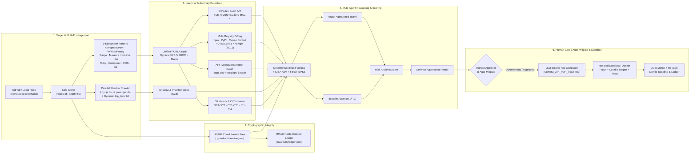

# Software Supply Chain Guardian

An agentic AI security platform that takes any repository (`owner/repo`, GitHub URL, or local checkout) from **discovery** and **cryptographic integrity verification** to **autonomous test generation, sandbox validation, and remediation**.


---

## Visual Architecture & End-to-End Dataflow



---

## Mathematical Equations & Scoring Formulas

### 1. Deterministic Vulnerability Risk Score ($0\text{–}100$)

$$\text{Risk}_{\text{vuln}} = \min\!\Big(100,\; \text{round}\big(S_{\text{cvss}} + E_{\text{exploit}} + X_{\text{scope}} + R_{\text{reach}} + D_{\text{direct}}\big)\Big)$$

| Factor | Equation / Value | Source |
|---|---|---|
| **Severity ($S_{\text{cvss}}$)** | $40 \times \frac{\text{CVSS}_{\text{v3/v4}}}{10}$ | OSV.dev advisory vector (`CVSS:3.1` or `CVSS:4.0`), or `10.0` for `MAL-*` |
| **Exploitability ($E_{\text{exploit}}$)** | $25 \text{ if } \text{CVE} \in \text{CISA KEV}, \text{ else } 15 \times P_{\text{EPSS}}$ | CISA Known Exploited Vulnerabilities & FIRST EPSS API |
| **Exposure ($X_{\text{scope}}$)** | $15 \text{ (prod)} \;\mid\; 3 \text{ (dev)}$ | Dual-pass BFS production path reachability |
| **Reachability ($R_{\text{reach}}$)** | $15 \text{ (direct import)} \;\mid\; 8 \text{ (transitive under imported)} \;\mid\; 0$ | Parallel source-code AST/regex crawler + `top_level.txt` |
| **Directness ($D_{\text{direct}}$)** | $5 \text{ (direct)} \;\mid\; 0 \text{ (transitive)}$ | Project manifest graph distance ($d = 1$) |

### 2. CVSS v3.x & CVSS v4.0 Base Score Equations

$$\text{ISS} = 1 - (1 - I_C)(1 - I_I)(1 - I_A), \qquad \text{Exploitability}_{\text{v3}} = 8.22 \times AV \times AC \times PR \times UI$$

$$\text{CVSS}_{\text{v3}} = \begin{cases} 0 & \text{if } \text{Impact} \le 0 \\ \text{RoundUp}\!\big(\min(1.08 \times (\text{Impact} + \text{Exploitability}),\; 10.0)\big) & \text{if Scope Changed} \\ \text{RoundUp}\!\big(\min(\text{Impact} + \text{Exploitability},\; 10.0)\big) & \text{if Scope Unchanged} \end{cases}$$

$$\text{CVSS}_{\text{v4}} = \text{ clamp}_{[0.1, 10.0]}\!\Big(\text{MacroVectorBase}(EQ_1, EQ_2, EQ_3, EQ_4) - \sum_{m \in \{AV,AC,AT,PR,UI,VA\}} w_m \cdot \Delta_m\Big)$$

### 3. Cryptographic 4096-Byte Merkle Tree & Hash-Chained Audit Ledger

$$\text{ChunkHash}_i = \text{SHA256}\big(\text{file}[4096i : 4096(i+1)]\big), \qquad H_{k}^{(l+1)} = \text{SHA256}\big(H_{2k}^{(l)} \;\|\; H_{2k+1}^{(l)}\big)$$

$$\text{PickIndex}(r, f, c) = \text{int}_{64}\!\Big(\text{HMAC-SHA256}\big(K_{\text{sign}},\; \text{nonce}_r \;\|\; f \;\|\; c\big)\Big) \bmod N_{\text{chunks}}$$

$$R_n = \text{SHA256}\big(n \;\|\; R_{n-1} \;\|\; \text{ CanonicalJSON}(\text{event}_n)\big), \qquad \sigma_n = \text{HMAC-SHA256}\big(K_{\text{sign}},\; R_n\big)$$

---

## Intelligence Sources, Tech Stack & Open Tools

| Category | Tools / APIs / Standards Used | Purpose |
|---|---|---|
| **AI & Agent SDKs** | **Official Google GenAI SDK (`google-genai` / `google.genai`)**, **Anthropic SDK (`anthropic`)** | Multi-key/model rotation for Attack, Integrity, Risk, Defense agents + dedicated `GEMINI_API_FOR_TESTING` smoke-test generator |
| **Vulnerability & Exploit Feeds** | **OSV.dev API** (`/v1/querybatch`), **CISA KEV** JSON feed, **FIRST EPSS** API (`/data/v1/epss`), **GitHub Security Advisories (`GHSA-*`)**, **OpenSSF Malicious Packages (`MAL-*`)** | Live CVE/GHSA lookup, malicious package separation, active exploitation & 30-day probability scoring |
| **Package Registries & Insights** | **Google Open Source Insights (`api.deps.dev`)**, **npm Registry** (`registry.npmjs.org`), **PyPI JSON API** (`pypi.org/pypi/<pkg>/json`), **Maven Central Solr** (`search.maven.org`), **Crates.io**, **RubyGems**, **Packagist** | Multi-ecosystem typosquat detection (`SC9`), `404` unknown provenance (`SC10`), release-age `< 7d` diffing (`SC11`), tarball integrity verification |
| **SBOM & Package Standards** | **CycloneDX 1.5 JSON** (`sbom.cdx.json`), **Package URL (`purl`)**, **CVSS v3.1 & v4.0**, **Subresource Integrity (SRI)** | Canonical component identification and machine-readable supply chain export |
| **Backend, Sandbox & Web Stack** | **Python 3.11+**, **FastAPI**, **Uvicorn**, **Docker / Docker Compose v2**, **Git CLI**, **Force-Graph (HTML5 Canvas)** | REST API, isolated container lockfile regeneration & smoke testing, interactive force-directed dependency network UI |

---

## Quick Start

```bash
python3 -m venv .venv && source .venv/bin/activate
pip install -e ".[all]"
cp .env.example .env          # set GEMINI_API_KEYS, GEMINI_API_FOR_TESTING, GUARDIAN_SIGNING_KEY
guardian serve                # open http://127.0.0.1:8000
```

### Command Line & Live Simulation

```bash
# Scan or run full pipeline (accepts owner/repo shorthand, full GitHub URL, or local path)
guardian scan OWASP/NodeGoat
guardian run  OWASP/NodeGoat --auto-merge

# Cryptographic Merkle baseline, random-chunk watch, ledger verification & human warning waiver
guardian baseline targets/live-demo --signer "lead-dev"
guardian watch    targets/live-demo --rounds 3
guardian verify-ledger targets/live-demo
guardian waive    targets/live-demo <finding_id> "Reviewed and accepted by security team"

# Simulate live attacks in a second terminal while watching the Web UI
python3 scripts/simulate_attacks.py targets/live-demo all
```

### Visual Slide Deck & Documentation
- **[Visual Presentation Deck (PPT-Style Diagrams & Equations)](docs/presentation.md)**
- **[System Architecture & Dataflow Charts](docs/architecture.md)**
- **[Requirements](docs/requirements.md)** · **[Implementation](docs/implementation.md)** · **[Operations](docs/operations.md)** · **[Responsible AI](docs/responsible-ai.md)**
