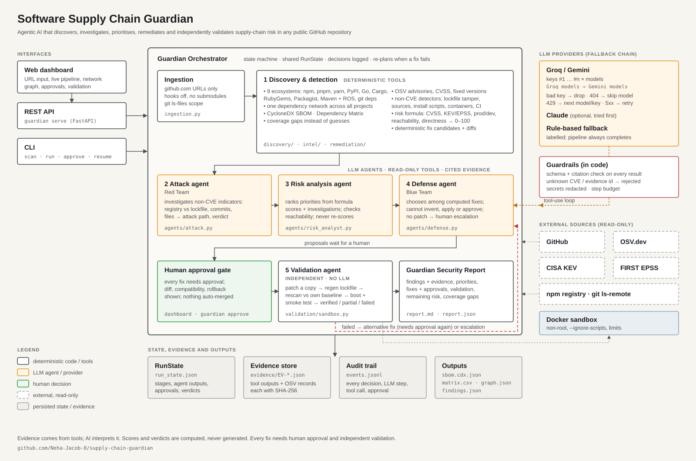

# Software Supply Chain Guardian

An agentic AI system that takes any public GitHub repository from **discovery** to **independently validated
remediation**: it maps the full dependency network, finds known vulnerabilities and suspicious supply-chain changes,
lets AI agents investigate and prioritise them, proposes fixes for human approval, and verifies each approved fix in
a sandbox before reporting.



**Principle:** evidence comes from deterministic tools; AI agents interpret it. Scores and verdicts are computed, never
generated. Every fix needs human approval and independent validation.

## Quick start

```bash
python3 -m venv .venv && source .venv/bin/activate
pip install -e ".[all]"
cp .env.example .env          # add GROQ_API_KEYS, GEMINI_API_KEYS, and/or ANTHROPIC_API_KEY
guardian serve                # open http://127.0.0.1:8000, paste a GitHub URL, press Analyse
```

Command line:

```bash
guardian scan https://github.com/OWASP/NodeGoat      # inventory, SBOM, matrix, vulnerabilities, indicators
guardian run  https://github.com/OWASP/NodeGoat      # full agentic pipeline; pauses at the approval gate
guardian approve --ids FIX-...,FIX-...               # human decision (or --ids low | all, --reject)
guardian resume targets/NodeGoat                     # independent validation + report
```

Options: `--llm auto|groq|gemini|claude|none`, `--offline` (cached data only), `--no-smoke` (skip runtime checks; static
validation remains partial),
`--history N` (lockfile commits to compare).

## What it does

| Stage | Who | Output |
|---|---|---|
| Ingestion | code | safe clone (github.com only, hooks off, no submodules), repository files only (`git ls-files`) |
| 1 Discovery & detection | deterministic tools | dependency network across 9 ecosystems, CycloneDX SBOM, Dependency Matrix, OSV vulnerabilities, non-CVE indicators, risk scores, fix candidates, coverage gaps |
| 2 Attack agent (Red Team) | LLM + read-only tools | investigations of suspicious indicators with attack paths, verified facts vs inference |
| 3 Risk analysis agent | LLM + read-only tools | ranked priorities with rationale (scores stay formula-based) |
| 4 Defense agent (Blue Team) | LLM + read-only tools | fix proposals chosen from computed candidates; patch-less fixes escalate to a human |
| Approval gate | human | approve / reject each fix (dashboard or CLI) |
| 5 Validation agent | deterministic | patch a copy, regenerate lockfile safely, rescan, run only a trusted profile's tests/smoke checks → verified / partial / failed |
| Apply | code | approved fixes that passed validation (verified, or static-only with a clean rescan) are written to a local branch `guardian/remediation-<time>`, one commit per fix (never pushed); `remediation.patch` |
| Report | code | `report.md` + `report.json`, audit trail in `events.jsonl` |

Details: [docs/requirements.md](docs/requirements.md) · [docs/implementation.md](docs/implementation.md) ·
flowcharts: [docs/architecture.md](docs/architecture.md) · [operations runbook](docs/operations.md) ·
[presentation runbook](docs/presentation.md) · [Responsible AI & security note](docs/responsible-ai.md) ·
[demo script](docs/demo.md)

## Supported ecosystems

| Ecosystem | Files | Graph |
|---|---|---|
| npm | `package-lock.json`, `npm-shrinkwrap.json`, `pnpm-lock.yaml` (workspaces), `yarn.lock` v1, `package.json` | full (declared only without a lockfile) |
| Python | `poetry.lock`, `uv.lock`, `Pipfile.lock`, `requirements*.txt` (pip-compile `# via` → edges), `pyproject.toml` | full / flat / declared |
| Go | `go.mod` | direct + indirect |
| Rust | `Cargo.lock` (+ `Cargo.toml` dev deps) | full |
| Ruby | `Gemfile.lock` | full |
| PHP | `composer.lock`, `composer.json` | full / declared |
| Java | `pom.xml` | declared |
| ROS | `package.xml` | declared rosdep keys |
| Git | `.repos` (vcstool), `.gitmodules` | declared |

Monorepos become one network with a node per project. Anything unresolved (ranges, missing lockfiles, Gradle,
C/C++ build files) is listed as a coverage gap rather than guessed. Tested on 20 public repositories across all of
the above, including pnpm monorepos, an empty repository and offline runs.

## LLM providers

Configured in `.env` (git-ignored). `GROQ_API_KEYS=k1,k2,k3,k4` are tried in order; rate-limit/auth failures rotate
to the next key and then the next configured model. Set `GUARDIAN_GROQ_MODELS` to override the default Groq model order.
`GEMINI_API_KEYS=k1,k2,k3` are also tried in order; per key, models are tried in order
(`gemini-3.5-flash` → `gemini-flash-latest` → lite models, override with `GUARDIAN_GEMINI_MODELS`). Invalid keys are
dropped, retired models skipped, quota errors move to the next model/key, overload is retried. If every key and
model fails, the agent restarts on the next provider (Claude, if `ANTHROPIC_API_KEY` is set) and finally runs its
labelled rule-based fallback, so the pipeline always completes. Keys are sent only as request headers and never logged.

## Outputs (`output/`)

| File | Contents |
|---|---|
| `matrix.csv` / `matrix.json` | Dependency Matrix: purl, ecosystem, direct/transitive, prod/dev, parent, full path, source, license, advisories, CVSS, severity, affected range, fixed version, risk status |
| `sbom.cdx.json` | CycloneDX 1.5 SBOM with hashes, sources and the dependency tree |
| `graph.json` | network nodes (repo, projects, packages) and edges |
| `findings.json` | vulnerabilities (verified, OSV) and indicators (rule-based), each with evidence and a risk breakdown |
| `run_state.json`, `events.jsonl`, `evidence/` | agent outputs, approvals, verdicts, applied fixes; audit trail; cited evidence |
| `remediation.patch` | the applied fixes as `git format-patch` output, ready for a pull request |
| `report.md` / `report.json` | Guardian Security Report |

## Repository layout

```
guardian/
  cli.py, api.py, config.py      CLI, REST API (FastAPI), .env loading
  ingestion.py                   GitHub URL validation and safe clone
  pipeline.py                    discovery + detection pipeline
  discovery/                     ecosystem parsers, network assembly, SBOM, matrix
  intel/                         OSV, detectors, risk scoring, registry lookups
  remediation/                   deterministic fix candidates
  agents/                        orchestrator, agent loop + guardrails, tools, state, Gemini/Claude backends, 3 agents
  agents/prompts/                agent system prompts (package data)
  validation/                    Docker sandbox validation
  reporting/                     report generator
  policies/                      risk weights, end-of-life dates, smoke profiles (editable data)
  web/                           dashboard (HTML/CSS/JS, served by `guardian serve`)
scripts/seed_demo.py             local lockfile-tamper demo branch
tests/                           54 unit tests (no network, no API key; optional SDK shape test uses anthropic)
docs/                            requirements, architecture, implementation, operations, presentation, responsible AI, demo
```

## Tests

```bash
uv run --with pyyaml --with fastapi --with uvicorn --with anthropic python -m unittest discover -s tests -t .
```

CI runs them on every push (GitHub Actions, SHA-pinned, read-only token).

## Safety

Only public `github.com` repositories are cloned, with git hooks disabled and no credential prompts. Target code
never runs on the host: lockfile regeneration uses `--ignore-scripts` and runs in Docker as a non-root user.
Unknown repositories never execute arbitrary Dockerfiles/Compose; runtime checks require an allowlisted remote
identity and pass a host-escape policy first. Repository secrets are redacted before anything reaches an LLM.
A fix reaches the repository only after human
approval and a passing validation, and then only as a local branch commit (git hooks disabled); nothing is merged,
pushed or deployed automatically.

## Known limitations

- Reachability is package-level (is the package imported), not function-level.
- Automatic patches cover npm and pinned Python requirements; other ecosystems get exact manual instructions.
- Lockfile history ("what changed") is analysed for npm lockfiles.
- Runtime validation uses a trusted smoke profile when one exists (`policies/smoke_profiles.json`); unknown or
  untrusted repositories receive a static rescan and an explicit `partial` verdict.
- Indicators are heuristics, not proof of compromise; the end-of-life table is a static snapshot.
