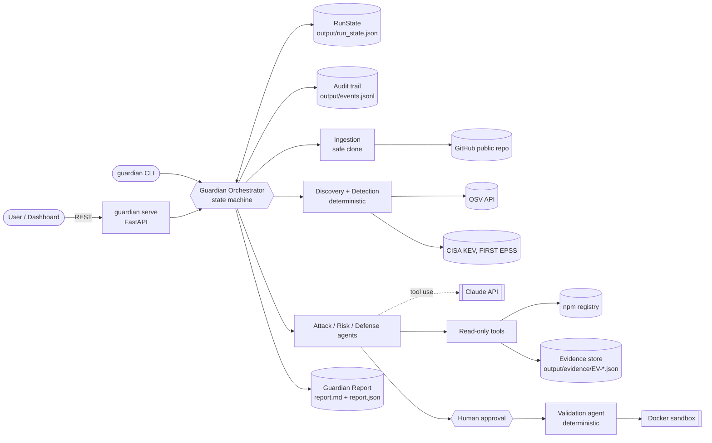
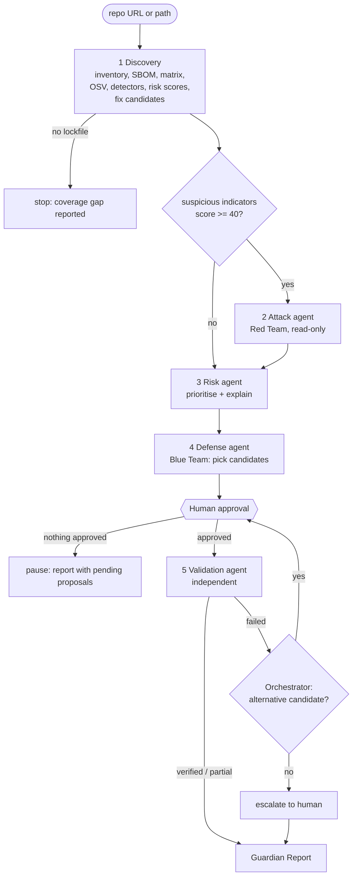
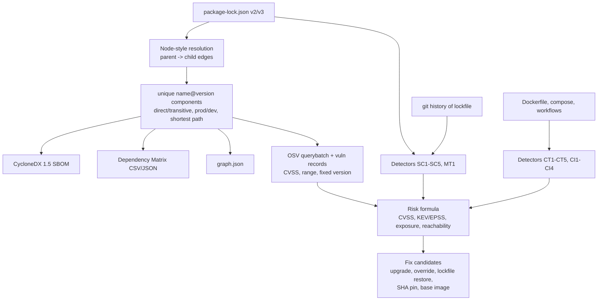
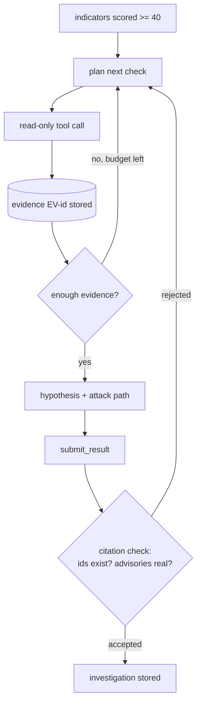
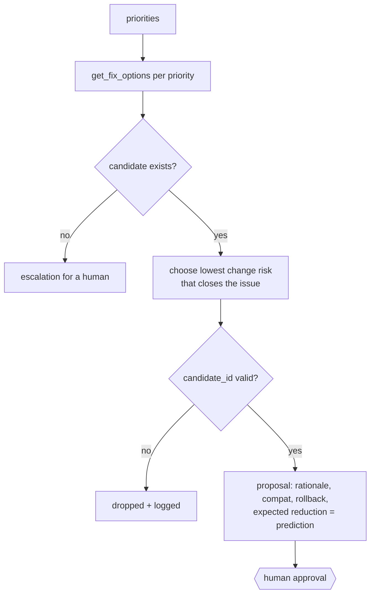
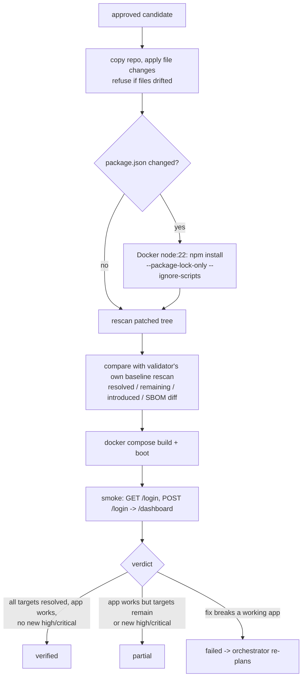

# Architecture

Software Supply Chain Guardian takes a repository from discovery to independently validated remediation.
Deterministic tools produce all evidence and all numbers; LLM agents investigate, prioritise and choose
among computed fixes; a human approves; an independent validator decides whether a fix worked.

## 1. System overview

## 2. Agentic workflow

| Agent | Kind | Tools | Output | Cannot |
|---|---|---|---|---|
| Orchestrator | code (state machine) | all stages | stage transitions, decisions, retries | — |
| Discovery | deterministic pipeline | lockfile parser, OSV, detectors, risk formula, candidate generator | inventory, findings, scores, candidates | — |
| Attack (Red Team) | LLM agent | `get_finding`, `get_component`, `npm_registry_metadata`, `git_commit_info`, `read_file`, `check_import_usage`, `list_findings` | investigations: hypothesis, attack path, verified facts vs inferences, verdict | write anything, execute code |
| Risk Analysis | LLM agent | `get_finding`, `get_component`, `check_import_usage`, `list_findings`, `read_file` | ranked priorities with rationale | change a score |
| Defense (Blue Team) | LLM agent | `get_fix_options`, `get_finding`, `get_component`, `check_import_usage`, `read_file` | proposals (candidate ids), escalations | invent a fix, apply a fix, declare success |
| Validation | deterministic | Docker, rescan, smoke test | verdict per fix | — (no LLM involved) |

Every agent has a labelled rule-based fallback, so the pipeline completes without an API key.

## 3. Discovery and detection pipeline

## 4. Red Team investigation

## 5. Blue Team remediation

## 6. Validation

## Evidence and approval points

- **Evidence**: OSV records (`output/cache/osv/*.json`, SHA-256 in each finding), file/line/commit excerpts for
  indicators, and every agent tool call (`output/evidence/EV-*.json`). Agents may only cite these ids.
- **Approval**: the orchestrator stops at `awaiting_approval`; `guardian approve` or
  `POST /api/proposals/{id}/approval` records the decision with time and reviewer in the audit trail.
- **Audit trail**: `output/events.jsonl` records every stage, decision, LLM step, tool call, rejected
  submission, approval and verdict.

## Code map

| Concern | Module |
|---|---|
| Ingestion | `guardian/ingestion.py` |
| Discovery | `guardian/discovery/` |
| Vulnerabilities, detectors, risk, registry | `guardian/intel/` |
| Fix candidates | `guardian/remediation/` |
| Agents, tools, state, orchestrator | `guardian/agents/` (prompts in `agents/prompts/`) |
| Validation | `guardian/validation/` |
| Report | `guardian/reporting/` |
| Policies (weights, EOL dates) | `guardian/policies/` |
| API / CLI | `guardian/api.py`, `guardian/cli.py` |
