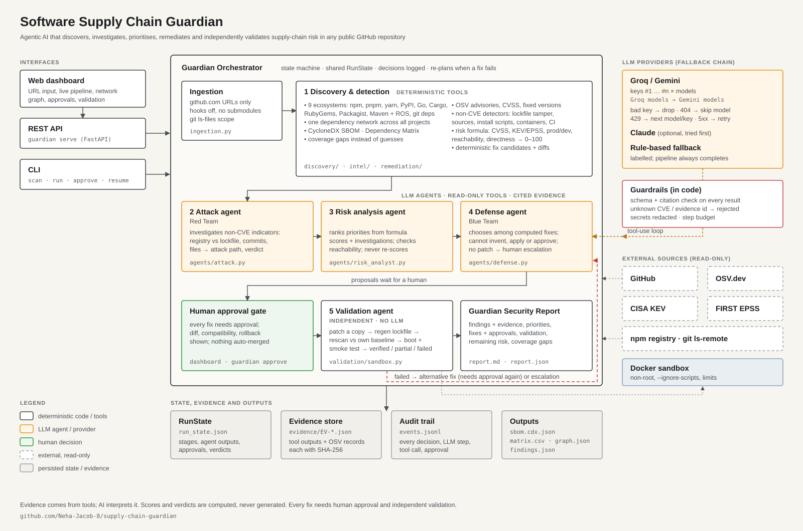
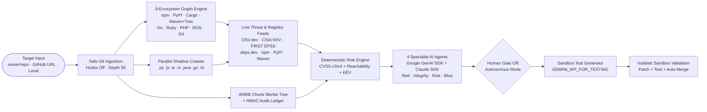
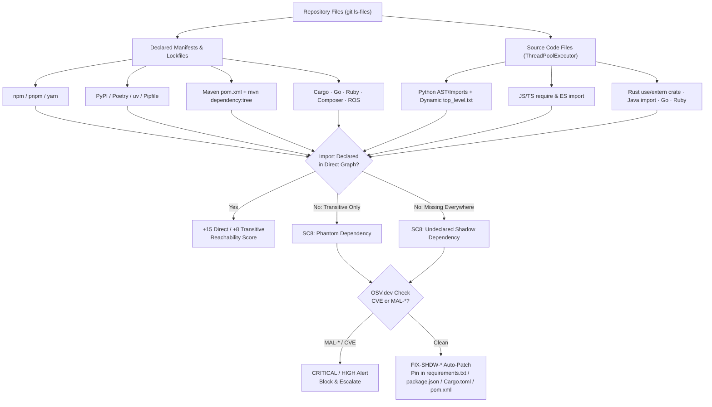
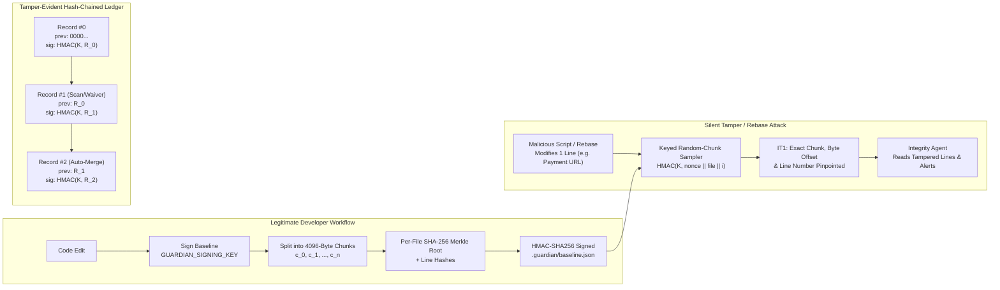
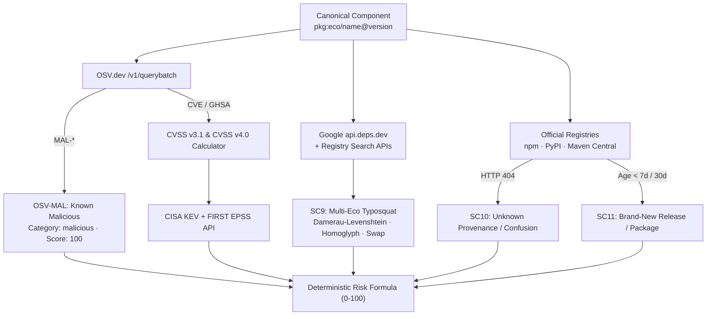
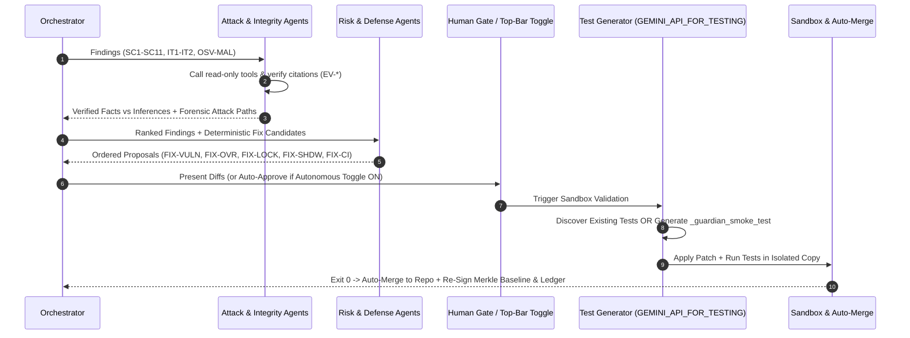
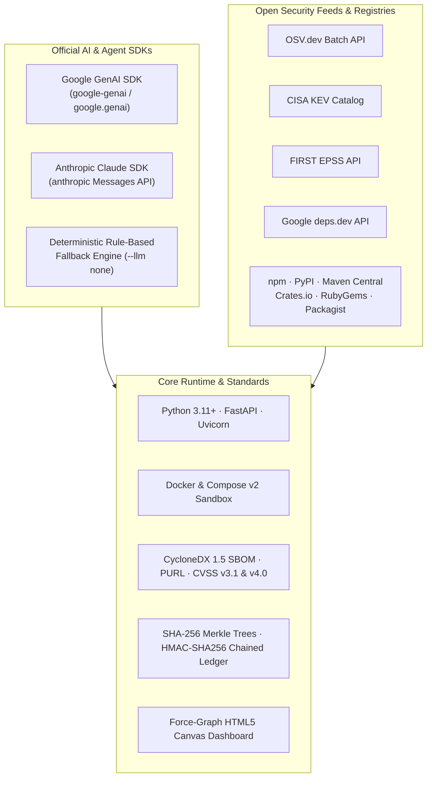

# Supply Chain Guardian — Visual Presentation Deck

---

## Slide 1: End-to-End Architecture & Dataflow

---

## Slide 2: Multi-Ecosystem Graph & Parallel Shadow Crawler

---

## Slide 3: Cryptographic 4096B Merkle Tree & Signed Audit Ledger

### Cryptographic Verification Equations

$$\text{MerkleLeaf}_i = \text{SHA256}\big(\text{FileBytes}[4096i : 4096(i+1)]\big), \qquad \text{SampleIdx} = \text{HMAC-SHA256}(K_{\text{sign}}, \text{nonce} \,\|\, \text{path} \,\|\, c) \bmod N$$

$$R_n = \text{SHA256}\big(n \,\|\, R_{n-1} \,\|\, \text{CanonicalJSON}(\text{Data}_n)\big), \qquad \text{HeadSig}_n = \text{HMAC-SHA256}(K_{\text{sign}}, R_n)$$

---

## Slide 4: Live Threat Intelligence & Mathematical Risk Engine

### Core Scoring Equations

$$\text{RiskScore} = \min\!\left(100,\; \underbrace{40 \cdot \frac{\text{CVSS}}{10}}_{\text{0–40 pts}} + \underbrace{\begin{cases} 25 & \text{in CISA KEV} \\ 15 \cdot \text{EPSS} & \text{otherwise} \end{cases}}_{\text{0–25 pts}} + \underbrace{\begin{cases} 15 & \text{prod} \\ 3 & \text{dev} \end{cases}}_{\text{3–15 pts}} + \underbrace{\begin{cases} 15 & \text{direct import} \\ 8 & \text{transitive import} \\ 0 & \text{unimported} \end{cases}}_{\text{0–15 pts}} + \underbrace{\begin{cases} 5 & \text{direct} \\ 0 & \text{transitive} \end{cases}}_{\text{0–5 pts}}\right)$$

$$\text{IndicatorScore} = \text{clamp}_{[0,100]}\!\Big(W_{\text{rule}} + X_{\text{prod/dev}} + H_{\text{git\_commit}}\Big), \qquad \text{Confidence} = \frac{N_{\text{observed\_factors}}}{5}$$

---

## Slide 5: Multi-Agent System & Autonomous Test-Driven Mitigation

---

## Slide 6: Complete Tech Stack, SDKs & Open Tools

